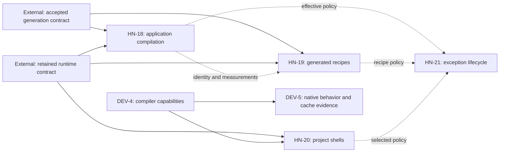

# Coordinate Horizon-inspired Haskell Nix performance and reliability improvements

This MasterPlan is a living cross-repository coordination document. Keep its registry, dependency declarations, Progress, Decision Log, and evidence current. The member ExecPlans remain the implementation contracts. Record durable implementation decisions in their owning repositories' ADRs.

## Vision & Scope


Improve evaluation and changed-application build time, provide project shells using the selected runtime, and make toolchain/dependency compatibility claims verifiable. The effort combines six existing ExecPlans owned by two repositories. It adds no new solver or runtime lock and leaves already completed snapshot work complete. A maintainer can inspect the exact published plans, their cross-repository dependencies, and currently ready work through Mori, without confusing equal numeric IDs in different projects.

The members are this repository's EP-18 (application compilation), EP-19 (pre-generated dependency recipes), EP-20 (runtime project shells), and EP-21 (compatibility exception lifecycle), plus compiler capability and native verification plans owned by `mori://shinzui/haskell-nix-dev` in its EP-4 and EP-5. Its existing toolchain master plan remains a local sub-master. Use canonical plan URIs for foreign references and repository-qualified labels in conversation; “EP-4” alone is ambiguous across these projects.

Only these six ExecPlans, this umbrella, and the toolchain sub-master opt into Mori publication. Existing cohort generation and retained runtime plans, application-adoption plans, older toolchain plans, and completed first-party snapshot plans remain outside this publication set. Dependencies may reference external plans without publishing their files. Hoogle/documentation tooling is outside the delivered scope.

EP-18 is included because its seed compatibility, source invalidation, and application recipe measurements overlap the exact compiler/source/policy/dependency identities verified by EP-19 and EP-21. It owns changed application compilation; EP-19 owns evaluation-time recipe generation. Shared identity and measurement contracts justify coordination without making either optimization a hard prerequisite for the other. Preserve EP-18's earlier declined Intention association; umbrella membership does not add one.

## Decomposition Strategy


Retain the existing implementation boundaries rather than copying plans into this repository or renumbering foreign work. The local toolchain sub-master is `mori://shinzui/haskell-nix-dev/masterplans/2-publish-verified-haskell-toolchain-capabilities-and-support-evidence` and still coordinates capability metadata before behavioral verification. The new umbrella coordinates runtime/source/policy identities, performance measurements, cross-repository shell integration, and exact publication scope across both projects.

[ADR 1](../adr/1-compose-first-party-snapshots-in-one-haskell-scope.md) requires one recursive package scope and real input identity for reuse. [ADR 2](../adr/2-resolve-the-rei-family-cohort-upgrade-only.md) preserves floors and exact sources/metadata. [ADR 4](../adr/4-consumer-overlays-define-only-their-own-packages.md) reserves shared dependency policy for the channel. [ADR 5](../adr/5-keep-routine-application-changes-independent-of-cohort-and-toolchain-updates.md) separates application edits from dependency/toolchain updates and requires measured reuse. [ADR 7](../adr/7-compose-applications-on-retained-keiro-runtime-baselines.md) protects retained runtime recipes. The toolchain repository has no pre-existing local ADR corpus; its members establish the declaration/evidence decisions there during implementation.

This is a management umbrella, not a claim that all work serializes. Pure fixtures, read-only diagnosis, and prototypes can proceed before production contracts are accepted. Mori's Hard edges represent conservative production-delivery prerequisites because it cannot express milestone-level gates. Integration edges record shared artifacts and coordination and do not block independent fixture progress.

## Exec-Plan Registry


The numeric rows below are local children, with repository-relative paths and `master_plan` backreferences. The qualified foreign rows remain children of their owning repository's toolchain sub-master. Mori is the cross-repository status source; Mina's local child roll-up does not resolve foreign URI paths and must not be presented as the whole initiative's progress.

| # | Title | Path | Hard Deps | Soft Deps | Status |
|---|-------|------|-----------|-----------|--------|
| 18 | Accelerate application code compilation in Nix builds | docs/plans/18-accelerate-application-code-compilation-in-nix-builds.md | External generation/runtime delivery | None | Not Started |
| 19 | Pre-generate complete locked Nix Haskell dependency recipes | docs/plans/19-pre-generate-complete-locked-nix-haskell-dependency-recipes.md | External generation/runtime delivery | None | Not Started |
| 20 | Build project development shells from retained runtime package sets | docs/plans/20-build-project-development-shells-from-retained-runtime-package-sets.md | External runtime delivery and DEV-4 | None | Not Started |
| 21 | Manage compatibility exceptions and verify their continued necessity | docs/plans/21-manage-compatibility-exceptions-and-verify-their-continued-necessity.md | None | None | Not Started |

## Cross-repository Exec-Plan Registry


The foreign workstream keeps its local child registry in the toolchain sub-master. Its member references are:

| Key | Title | Canonical reference | Hard prerequisite | Status |
|-----|-------|---------------------|-------------------|--------|
| DEV-4 | Publish compiler capabilities and an explicit platform support matrix | mori://shinzui/haskell-nix-dev/plans/4-publish-compiler-capabilities-and-an-explicit-platform-support-matrix | None | Not Started |
| DEV-5 | Exercise GHC Cabal and HLS in toolchain compatibility checks | mori://shinzui/haskell-nix-dev/plans/5-exercise-ghc-cabal-and-hls-in-toolchain-compatibility-checks | DEV-4 | Not Started |

The separate foreign registry is intentionally outside the local numeric registry. Resolve their canonical references through Mori for their files and status. Existing local EP-4, “Define immutable family snapshots and update cohorts,” is complete and is not DEV-4 or a member of this effort.

## Dependency Graph


DEV-5 has a Hard prerequisite on DEV-4's policy/capability contract. EP-20 has a Hard prerequisite on DEV-4 for production compiler/scope validation. EP-18, EP-19, and EP-20 have conservative Hard production-delivery prerequisites on the accepted generation and/or retained runtime contracts detailed below. These gates do not prevent their initial fixture work. EP-21's migration and verification fixtures have no Hard prerequisite among this effort's members.

The external generation contract is [plan 9](../plans/9-generate-the-nix-package-set-from-the-cohort-freeze-and-guard-version-parity.md), with canonical reference `mori://shinzui/haskell-nix/plans/9-generate-the-nix-package-set-from-the-cohort-freeze-and-guard-version-parity` for registry edges. The external runtime contract is [plan 16](../plans/16-create-the-keiro-runtime-package-set-and-compose-applications-on-it.md), with canonical reference `mori://shinzui/haskell-nix/plans/16-create-the-keiro-runtime-package-set-and-compose-applications-on-it` for registry edges. EP-18 and EP-19 consume both for production rollout; EP-20 consumes the runtime contract, which already depends on generator delivery. Application adoption remains an additional real-consumer acceptance condition in the child plans, without publishing its unrelated plan files here.

Publish Integration edges from this umbrella to its six ExecPlans and the toolchain sub-master, and from that sub-master to its two children. These are membership/coordination records, not execution blockers. EP-18 coordinates with EP-19 on phase-separated measurements and EP-21 on effective policy identity. EP-19 and EP-20 coordinate with EP-21 on generated/selected effective policy. EP-21's integrations with existing generator/runtime contracts remain advisory; it does not retroactively block those existing plans.



Solid edges are Hard production-delivery prerequisites; dotted edges are Integration relationships. There are no Hard cycles. External prerequisites are referenced without opting their files into this catalog. If they are unpublished in Mori, the graph intentionally shows unresolved terminal prerequisite nodes and readiness remains blocked. Do not fabricate completion facts or publish unrelated plans just to clear those markers.

## Integration Points


DEV-4 owns the toolchain declaration/capability schema; DEV-5 owns native tool execution and fresh-worker cache evidence. EP-20 consumes the delivered compiler identity to construct a compatible shell, preserving the independent HLS closure. The toolchain flake receives no reverse application dependency. Both toolchain children remain under their existing local master plan and retain their own intentions.

EP-19 owns full generated dependency recipes and evaluation measurements. EP-18 owns application intermediates/source boundaries, bounded compilation settings, and changed-source compilation measurements. Keep evaluation, generation, substitution, dependency compilation, application compilation/linking, and tests separate in receipts. Their common baseline identifies the exact compiler/system/source/configuration; a warm unchanged build cannot be used as a changed-code speedup. EP-18's compatibility record validates effective inputs without depending on EP-19's optimized representation.

EP-21 owns exception IDs, scope/retirement predicates, explicit bounds/test policies, and policy-validation receipts. EP-19 records effective policy in generated recipes; EP-20 selects a retained policy in its shell scope; EP-18 uses effective flags and dependency identities for seed compatibility. They coordinate semantic identity without pulling descriptive catalog text or receipt timestamps into derivations. Necessary repairs are not removed to improve a benchmark. Metadata migrations preserve production derivations; genuine changes produce new profiles/configurations and invalidate affected dependents.

Existing plans 9 and 16 retain ownership of generator contexts, executable graph manifests, comparator, retained runtime records, and their publication contracts. All workstreams reuse those APIs when delivered instead of introducing another solver, metadata parser, publisher, or runtime lock. Their files and intentions are not reparented into this umbrella.

Shared edits to `flake.nix`, `checks/default.nix`, `lib/`, and updater modules require per-plan ownership: EP-19 wires recipe generation, EP-20 wires shell construction, EP-21 wires exception/validation policy, and EP-18 wires application-only incremental helpers. Coordinate merge order and update shared interfaces in both consumers and owners. Each member retains its self-contained implementation and acceptance; this master plan records reconciliation.

## Progress


- [ ] HN-18: Prove native application compilation savings and guarded input compatibility.
- [ ] HN-19: Deliver deterministic recipes and scoped no-IFD evaluation/build evidence.
- [ ] HN-20: Deliver compatible runtime-derived project shells and consumer acceptance.
- [ ] HN-21: Deliver exception lifecycle, strict-validation receipts, and a real narrowing pilot.
- [ ] DEV-4: Deliver compatible compiler/capability metadata without changing tool derivations.
- [ ] DEV-5: Deliver native behavioral and fresh-worker retrieval evidence.
- [ ] Integration: Reconcile shared identities, phase-separated measurements, and retained history.

## Surprises & Discoveries


Source inspection of Mori's current plan model found that parent master-plan IDs are project-scoped. The `--master-plan` ready-child selector only returns local children; putting a foreign URI into `master_plan` cannot create cross-project parent membership safely. Keep local backreferences and query both publishing projects for the cross-repository view.

Mori registration accepts references to unpublished external prerequisites, and its Hard DAG represents them as unresolved terminal nodes. This preserves the user's scoped publication instruction while exposing missing readiness evidence. Both repositories initially published no agent plans. Exact publication-set checks subsequently confirmed five rows for this project and three for the toolchain project; re-publication must preserve that set and all typed edges. No implementation completion or performance evidence is inferred from creating this coordination document.

## Decision Log


2026-10-14: Create one umbrella at the user's request for cross-repository tracking, preserving the toolchain sub-master and independent workstream boundaries. All six ExecPlans remain independently scoped and no artificial Hard dependency is introduced between the two performance optimizations.

2026-10-14: Include EP-18 after checking actual overlap with compiler/source/policy/dependency identity and measurement contracts. Preserve its declined intention association and existing experimental acceptance; inclusion does not assert incremental compilation already works.

2026-10-14: Opt in exactly eight documents: six member ExecPlans and two coordination master plans. Existing generation/runtime/adoption plans remain external references and are not published by this effort. Publication updates only the two owning projects, not the whole Mori registry.

2026-10-14: Preserve local numeric parent relationships. Use Integration catalog edges for umbrella membership, Hard edges for conservative production-delivery prerequisites, and Mori project-scoped queries for global status. Unresolved external prerequisites remain visible rather than receiving synthetic status.

## Outcomes & Retrospective


Coordination and scoped registration were established on 2026-10-14. Mori contains exactly eight effort documents: six member ExecPlans and two master plans. The Hard graph has ten nodes (eight published members and two unresolved external prerequisites) and seven edges, with no cycles. The six implementation plans remain Not Started. Ready-work queries return HN-21 and DEV-4; each retains its independent fixture work and acceptance. Completion requires the six independently verified outcomes, real native evidence on every claimed supported platform, compatible shared identity contracts, and ADR distillation in the owning repositories. Registry publication and a successful acyclic graph alone do not complete this initiative.

## Tracking and Registration


The explicit membership allowlist is the four local ExecPlans in the registry above, the two foreign ExecPlans, this master plan, and the toolchain sub-master. `mori_publish: true` is set only on those documents. `mina mori publish --strict` writes each repository's `mori/agent-plans.dhall`; typed dependencies are maintained with `mina mori dependency suggest PLAN --uri URI --kind KIND`. Re-publishing retains dependencies. Validate and register only each owning checkout, then verify its exact file/URI set. New plans require an explicit membership decision before opting in; do not add broad include globs.

From the Mori-resolved `mori://shinzui/haskell-nix` checkout and then the `mori://shinzui/haskell-nix-dev` checkout, use:

```bash
mina mori publish --strict
mori validate
mori register --local
mina mori publish --strict --dry-run
```

A second publish must be a no-op. Dependency changes require re-registration after the catalog is written. `mori validate --check-refs` can report the deliberately unpublished external prerequisite references; preserve and explain those rather than expanding the publication set.

The cross-repository status and ready-work queries can run from either checkout:

```bash
mori plans list --project shinzui/haskell-nix --json
mori plans list --project shinzui/haskell-nix-dev --json
mori plans graph --project shinzui/haskell-nix --project shinzui/haskell-nix-dev --json --contract-version 1
mori plans deps --next-implementable --project shinzui/haskell-nix --json
mori plans deps --next-implementable --project shinzui/haskell-nix-dev --json
mori plans deps mori://shinzui/haskell-nix/masterplans/4-coordinate-horizon-inspired-haskell-nix-performance-and-reliability-improvements --json
```

The two lists must contain only five local publishing rows and three toolchain publishing rows. The graph closes over Hard external prerequisites, so unresolved prerequisite nodes are distinct from published effort members. DEV-4 and EP-21 are initially independent ready candidates; EP-18/19/20 remain conservatively gated for production and DEV-5 waits on DEV-4. Prototype work can still proceed as their plans allow. After completing a member, update its checklist/registry status, publish and register its owning project, and requery both projects. Do not interpret a local `--master-plan` result as the global six-plan selection.

## Revision Notes


2026-10-14: Created the cross-repository umbrella, included EP-18 based on verified overlap, preserved the existing toolchain sub-master, and scoped Mori publication to the eight effort documents. Coordination metadata does not change implementation ownership or completion status.
