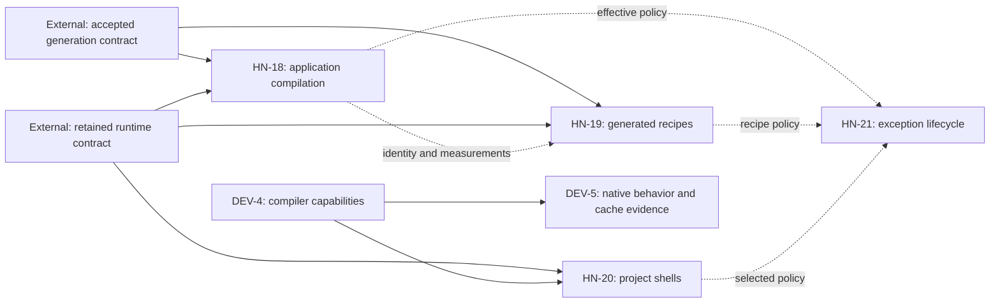

# Coordinate Horizon-inspired Haskell Nix performance and reliability improvements

This MasterPlan is a living cross-repository coordination document. Keep its registry, dependency declarations, Progress, Decision Log, and evidence current. The member ExecPlans remain the implementation contracts. Record durable implementation decisions in their owning repositories' ADRs.

## Vision & Scope


Make routine package-set updates easier to review and repeat, reduce evaluation and changed-application build time, provide project shells using the selected runtime, and make toolchain/dependency compatibility claims verifiable. The effort combines six existing ExecPlans owned by two repositories. It adds no new solver or runtime lock and leaves already completed snapshot work complete. A maintainer can inspect the exact published plans, their cross-repository dependencies, and currently ready work through Mori, without confusing equal numeric IDs in different projects.

The members are this repository's EP-18 (application compilation), EP-19 (pre-generated dependency recipes), EP-20 (runtime project shells), and EP-21 (compatibility exception lifecycle), plus compiler capability and native verification plans owned by `mori://shinzui/haskell-nix-dev` in its EP-4 and EP-5. Its existing toolchain master plan remains a local sub-master. Use canonical plan URIs for foreign references and repository-qualified labels in conversation; “EP-4” alone is ambiguous across these projects.

Only these six ExecPlans, this umbrella, and the toolchain sub-master opt into Mori publication. Existing cohort generation and retained runtime plans, application-adoption plans, older toolchain plans, and completed first-party snapshot plans remain outside this publication set. Dependencies may reference external plans without publishing their files. Hoogle/documentation tooling is outside the delivered scope.

EP-18 is included because its seed compatibility, source invalidation, and application recipe measurements overlap the exact compiler/source/policy/dependency identities verified by EP-19 and EP-21. It owns changed application compilation; EP-19 owns evaluation-time recipe generation. Shared identity and measurement contracts justify coordination without making either optimization a hard prerequisite for the other. Umbrella membership initially preserved EP-18's declined Intention association. The explicitly invoked implementation skill now inherits this umbrella's authoritative Intention ID for the current work.

### Observable outcomes


Package-set maintenance succeeds when a maintainer can take one targeted dependency update through the existing solver, inspect its version/source/metadata/policy impact, regenerate recipes, check applicable exceptions, build a real consumer, and roll back by selecting the prior retained generation. Unrelated selections remain fixed; a second generation run produces no diff; historical recipes keep their identities. EP-19 owns this integrated rehearsal, using EP-21's policy report when available and the existing explicit policy evidence otherwise. EP-21 remains independently deliverable. Record the commands, manual interventions, elapsed maintenance time, changed recipe count, affected dependent count, and any unexplained rebuilds. Adding a second source of package truth or requiring hand edits to generated recipes fails this outcome.

Faster builds require two distinct results: lower measured evaluation cost for EP-19's declared roots and lower end-to-end time to produce a changed production application for EP-18. Shell consistency and compatibility evidence improve maintenance/reliability; neither is itself a compiler speedup. Preserve production optimization, required tests, exact inputs and cache trust when comparing. Existing dependency-cache delivery is a baseline to preserve, not a new benefit of this initiative.

Before tuning, EP-18 M1 and EP-19 M1 record their representative workloads and practical improvement thresholds, expressed in seconds or percentages above observed baseline variability. Use at least five paired trials, report medians and spread, alternate baseline/candidate order, and keep hardware, jobs, memory limits, compiler, dependencies and build settings fixed. Use fresh evaluation processes with the evaluation cache controlled identically; use distinct declared source variants for changed-code trials so the target is not already built. Record unchanged warm builds separately from first-use, warm-dependency changed-code and fresh-worker substitution cases. No store deletion is needed.

Include generation, seed creation/refresh, downloads, evaluation, dependency builds, application compilation/linking and tests in the total cost. For extra one-time cost C and per-use saving S, report break-even as ceil(C/S), with seed refresh frequency, transferred/retained bytes and expected uses stated; no positive S means no amortized performance claim. Accept defaults only when the predeclared threshold and realistic total-cost budget pass. Inconclusive or negative experiments stay opt-in or are discarded and leave the relevant performance outcome unmet. A useful maintenance-only improvement may be retained with that narrower description; it cannot satisfy the faster-build acceptance.

## Decomposition Strategy


Retain the existing implementation boundaries rather than copying plans into this repository or renumbering foreign work. The local toolchain sub-master is `mori://shinzui/haskell-nix-dev/masterplans/2-publish-verified-haskell-toolchain-capabilities-and-support-evidence` and still coordinates capability metadata before behavioral verification. The new umbrella coordinates runtime/source/policy identities, performance measurements, cross-repository shell integration, and exact publication scope across both projects.

[ADR 1](../adr/1-compose-first-party-snapshots-in-one-haskell-scope.md) requires one recursive package scope and real input identity for reuse. [ADR 2](../adr/2-resolve-the-rei-family-cohort-upgrade-only.md) preserves floors and exact sources/metadata. [ADR 4](../adr/4-consumer-overlays-define-only-their-own-packages.md) reserves shared dependency policy for the channel. [ADR 5](../adr/5-keep-routine-application-changes-independent-of-cohort-and-toolchain-updates.md) separates application edits from dependency/toolchain updates and requires measured reuse. [ADR 7](../adr/7-compose-applications-on-retained-keiro-runtime-baselines.md) protects retained runtime recipes. The restored toolchain plans confirm no pre-existing ADR corpus. DEV-4 now includes a filesystem decision separating declared support from observed evidence; its canonical project is `mori://shinzui/haskell-nix-dev`, project-relative `docs/adr/1-publish-declared-toolchain-support-separately-from-evidence.md` (artifact-level URI pending).

This is a management umbrella, not a claim that all work serializes. Pure fixtures, read-only diagnosis, and prototypes can proceed before production contracts are accepted. Mori's Hard edges represent conservative production-delivery prerequisites because it cannot express milestone-level gates. Integration edges record shared artifacts and coordination and do not block independent fixture progress.

## Exec-Plan Registry


The numeric rows below are local children, with repository-relative paths and `master_plan` backreferences. The qualified foreign rows remain children of their owning repository's toolchain sub-master. Mori is the cross-repository catalog when available; checked-in acceptance evidence determines whether local prerequisites are satisfied; Mina's local child roll-up does not resolve foreign URI paths and must not be presented as the whole initiative's progress.

| # | Title | Path | Hard Deps | Soft Deps | Status |
|---|-------|------|-----------|-----------|--------|
| 18 | Accelerate application code compilation in Nix builds | docs/plans/18-accelerate-application-code-compilation-in-nix-builds.md | Plans 9 and 16 (Complete locally; consumer rollout evidence still required) | None | In Progress |
| 19 | Pre-generate complete locked Nix Haskell dependency recipes | docs/plans/19-pre-generate-complete-locked-nix-haskell-dependency-recipes.md | Plans 9 and 16 (Complete locally; consumer rollout evidence still required) | None | In Progress |
| 20 | Build project development shells from retained runtime package sets | docs/plans/20-build-project-development-shells-from-retained-runtime-package-sets.md | Plan 16 (Complete locally); DEV-4 (Complete) | None | Complete |
| 21 | Manage compatibility exceptions and verify their continued necessity | docs/plans/21-manage-compatibility-exceptions-and-verify-their-continued-necessity.md | None | None | Complete |

## Cross-repository Exec-Plan Registry


The foreign workstream keeps its local child registry in the toolchain sub-master. Its member references are:

| Key | Title | Canonical reference | Hard prerequisite | Status |
|-----|-------|---------------------|-------------------|--------|
| DEV-4 | Publish compiler capabilities and an explicit platform support matrix | mori://shinzui/haskell-nix-dev/plans/4-publish-compiler-capabilities-and-an-explicit-platform-support-matrix | None | Complete |
| DEV-5 | Exercise GHC Cabal and HLS in toolchain compatibility checks | mori://shinzui/haskell-nix-dev/plans/5-exercise-ghc-cabal-and-hls-in-toolchain-compatibility-checks | DEV-4 | In Progress |

The separate foreign registry is intentionally outside the local numeric registry. Resolve their canonical references through Mori for their files and status. Existing local EP-4, “Define immutable family snapshots and update cohorts,” is complete and is not DEV-4 or a member of this effort.

## Dependency Graph


DEV-5 has a Hard prerequisite on DEV-4's policy/capability contract. EP-20 has a Hard prerequisite on DEV-4 for production compiler/scope validation. EP-18, EP-19, and EP-20 have conservative Hard production-delivery prerequisites on the accepted generation and/or retained runtime contracts detailed below. These gates do not prevent their initial fixture work. EP-21's migration and verification fixtures have no Hard prerequisite among this effort's members.

The external generation contract is [plan 9](../plans/9-generate-the-nix-package-set-from-the-cohort-freeze-and-guard-version-parity.md), with canonical reference `mori://shinzui/haskell-nix/plans/9-generate-the-nix-package-set-from-the-cohort-freeze-and-guard-version-parity` for registry edges. The external runtime contract is [plan 16](../plans/16-create-the-keiro-runtime-package-set-and-compose-applications-on-it.md), with canonical reference `mori://shinzui/haskell-nix/plans/16-create-the-keiro-runtime-package-set-and-compose-applications-on-it` for registry edges. EP-18 and EP-19 consume both for production rollout; EP-20 consumes the runtime contract, which already depends on generator delivery. Application adoption remains an additional real-consumer acceptance condition in the child plans, without publishing its unrelated plan files here.

Publish Integration edges from this umbrella to its six ExecPlans and the toolchain sub-master, and from that sub-master to its two children. These are membership/coordination records, not execution blockers. EP-18 coordinates with EP-19 on phase-separated measurements and EP-21 on effective policy identity. EP-19 and EP-20 coordinate with EP-21 on generated/selected effective policy. EP-21's integrations with existing generator/runtime contracts remain advisory; it does not retroactively block those existing plans.



Solid edges are Hard production-delivery prerequisites; dotted edges are Integration relationships. There are no Hard cycles. External prerequisites are referenced without opting their files into this catalog. If they are unpublished in Mori, the graph can show unresolved terminal prerequisite nodes even after local acceptance. Distinguish catalog readiness from implementation readiness: verify the whole prerequisite plan and its evidence locally, record that result here, and retain the catalog edges. Do not fabricate publication facts or publish unrelated plans just to clear those markers.

### Execution priorities and current prerequisites


As of 2026-10-16, plans 9 and 16 are Complete in their local progress and MP-3 records. The tree contains the live generator, `lib/mkRuntimePackageSet.nix`, checked composition/manifests and fingerprint-bound support receipts for `keiro-runtime` generations 1 and 2 under `cabal/runtime-cache/keiro-runtime/`. Both generations declare GHC 9.12.4 on Apple Silicon and x86 Linux in both source channels. This review inspected the code and retained evidence, without rerunning native builds. These external production prerequisites are satisfied locally; application adoption and each member's new acceptance still require their own evidence.

Start EP-18 M1 with representative changed-build baselines, then execute M3 source/stamp invalidation fixes before expanding seed reuse. Continue M2 only if M1 demonstrates a correct reuse mechanism; otherwise take the existing M4 package-boundary path, preserving the requirement for a measured changed-build improvement. M4 tuning and M5 rollout follow accepted evidence. This explicitly interleaves that child's milestones without adding a dependency on EP-19 or EP-21.

EP-19 can now start against the delivered generator/runtime interfaces. Its M1 must compare a real retained dependency root as well as the toy fixture before expanding conversion across the package set. EP-21 M1–M4 can proceed independently; share its effective policy contract before integrating new policy representation into EP-19. Run EP-19's targeted-update rehearsal once its M2/M3 artifacts work, then repeat it for M4's real consumer. Defer broader matrices and package splitting until these small producer/consumer checks establish benefit.

EP-20 fixtures can proceed, but production shell delivery and DEV-5 retain their whole-child DEV-4 prerequisite. The user restored the foreign plans upstream; the owning checkout was pulled to `08bc32146d0c5a712b6f2fdb1650acf254bd8304`. Their contracts and intentions are reconciled. DEV-4’s policy/capability API, channel discovery, documentation and legacy identity checks are implemented, with 25 native Apple Silicon fixtures passing. All tools, bundles and shells preserve their derivations across three systems. DEV-4 is Complete at `mori://shinzui/haskell-nix-dev` revision `0bd206a`: all 25 Linux policy fixtures and both unchanged bundles pass in the user-selected Apple guest, and actual identities and legacy/channel integration match. Its retained observation is project-relative `docs/evidence/toolchain-capability-linux.json` (artifact-level URI pending). Translation and guest sandbox/syscall-filter limits remain explicit. This satisfies the whole-child prerequisite for EP-20 production shells and DEV-5; GHC/Cabal/Setup/HLS smoke and fresh-worker claims remain DEV-5 work. Mori discovery still fails because its database is absent; checked-in progress is distinguished from an unrefreshed catalog. This does not block local EP-18/19/21 work.

## Integration Points

EP-18 now exports opt-in `lib.mkApplicationIncrementalBuild`, with an explicit caller `pkgs` context and schema-1 compatibility records. Source-independent effective recipe identities retain all tools, flags, hooks and dependency inputs; separate metadata/layout/generated-source guards constrain eligible edits. This does not alter retained runtime or shared dependency recipes. Native fixture and pure guard checks pass; application adoption still requires paired timings, behavioral/test evidence and total-cost acceptance.


DEV-4 owns the toolchain declaration/capability schema; DEV-5 owns native tool execution and fresh-worker cache evidence. EP-20 consumes the delivered compiler identity to construct a compatible shell, preserving the independent HLS closure. The toolchain flake receives no reverse application dependency. Both toolchain children remain under their existing local master plan and retain their own intentions.

EP-19 owns full generated dependency recipes, evaluation measurements, and the targeted package-update rehearsal documented in `docs/user/maintainer-tools.md`. EP-18 owns the common benchmark receipt fields in `scripts/measure-application-nix-builds.py`; EP-19 records the same input, trial, phase and cache-state fields in its own measurements without waiting for that script to exist. EP-21 owns policy-report data consumed by the rehearsal. The final integration review reconciles those receipts without introducing a new benchmark service or command framework.

EP-18 owns application intermediates/source boundaries, bounded compilation settings, and changed-source compilation measurements. Keep evaluation, generation, substitution, dependency compilation, application compilation/linking, and tests separate in receipts. Their common baseline identifies the exact compiler/system/source/configuration; a warm unchanged build cannot be used as a changed-code speedup. EP-18's compatibility record validates effective inputs without depending on EP-19's optimized representation.

EP-21 owns exception IDs, scope/retirement predicates, explicit bounds/test policies, and policy-validation receipts. EP-19 records effective policy in generated recipes; EP-20 selects a retained policy in its shell scope; EP-18 uses effective flags and dependency identities for seed compatibility. They coordinate semantic identity without pulling descriptive catalog text or receipt timestamps into derivations. Necessary repairs are not removed to improve a benchmark. Metadata migrations preserve production derivations; genuine changes produce new profiles/configurations and invalidate affected dependents.

Existing plans 9 and 16 retain ownership of generator contexts, executable graph manifests, comparator, retained runtime records, and their publication contracts. EP-19 must add a new retained generation/configuration for a changed recipe representation: the delivered runtime factory imports captured recipe code and checks final derivations against its captured reference, so overlaying new recipes onto an old generation is not an adoption mechanism. Its parity and timing checks must exercise that checked constructor, including the reference-validation path, before a wider rollout. No-IFD acceptance remains scoped to generated roots: diagnose the full constructor too, but explicitly report residual first-party/application IFD without bypassing the guard or claiming a fully IFD-free runtime. All workstreams reuse those delivered APIs instead of introducing another solver, metadata parser, publisher, or runtime lock. Their files and intentions are not reparented into this umbrella.

Shared edits to `flake.nix`, `checks/default.nix`, `lib/`, and updater modules require per-plan ownership: EP-19 wires recipe generation, EP-20 wires shell construction, EP-21 wires exception/validation policy, and EP-18 wires application-only incremental helpers. Coordinate merge order and update shared interfaces in both consumers and owners. Each member retains its self-contained implementation and acceptance; this master plan records reconciliation.

## Progress

2026-10-18 UTC: EP-19 M2/M3 are accepted for portable tooling and the explicit bounded retained configuration. Generation 4's selected and independent reference constructors preserve all 273 non-boot runtime derivations and actual immutable Rei CLI identity in all four cells; declared-root no-IFD passes, while unconverted Diff remains the whole-constructor boundary. Immutable `3453274` passes both complete platform gates (344.061 s Darwin, 533.951 s translated Linux), all 356 pure contracts, 225 updater tests, converter freshness, parity and existing cache-identity checks. [Final matrix](../evidence/ep19/retained-recipe-native-matrix.json). M4 requires targeted update/rollback, measured evaluation and total-cost acceptance, publication and adoption. Broad generation-4 support stays unverified; no consumer/default moved. EP-18 timing remains paused after three foreign-work interruptions, with every attempt excluded and costs retained; its native 4,241-case resource-aware split correctness is accepted without performance/adoption acceptance. Pending toolchain CI push approval is unchanged.

2026-10-17 EP-21 is Complete: exact scoped policy/retirement evidence, post-update cohort/history/report identities and both full immutable platform gates pass at `2565350`. There are 313 passing pure contracts and 209 updater tests; documentation and ADR 8 are validated. [Final evidence](../evidence/ep21/policy-final-acceptance.json). Generation-3 broad runtime support remains unverified and existing consumers stay fixed. EP-20/DEV-4 remain Complete; EP-18/19 and hosted DEV-5 acceptance remain In Progress. No performance threshold or publication approval gate is weakened.

2026-10-17 EP-21 retirement checkpoint: the real servant-docs r3 no-entry probe and receipt replays pass in all four Darwin/Linux source-channel contexts. Its redundant live metadata row/catalog binding are retired; four Darwin cohort cells and both retained-generation-3 report contexts preserve exact identities. Native focused checks and 209 updater tests pass. [Evidence](../evidence/ep21/servant-docs-retirement.json). Final immutable Linux/history/full-gate acceptance remains active; generation-3 broad runtime support stays unverified and member status remains In Progress.

2026-10-17 EP-21 retained-report handoff: generation 3 can explicitly capture/report through its own immutable catalog, preserving current recipes and rejecting unavailable generation-1/2 hooks. Both Darwin CLI checks pass; both Linux channels preserve all 311 owned entries across generations 1/2/3. Actual selected-policy impact identifies only two bytestring-lexing declarations and thirteen unchanged declarations per channel. [Evidence](../evidence/ep21/retained-policy-capture.json). Full corrected gates and Linux removal/capture remain open.

2026-10-17 EP-21 retention checkpoint: selected-policy revision `727167e` passes the full translated Linux gate. Generation 3 captures the accepted named policy, preserves all owned Darwin identities across generations 1/2/3 and passes six focused checks; its support remains unverified. The real `servant-docs` r3 no-entry probe passes its complete Darwin suite, graph, behavior and receipt replay. No retirement has occurred; immutable Linux generation/removal checks remain active. See [the checkpoint](../evidence/ep21/policy-retention-checkpoint.json).

2026-10-17 EP-21 M4 continuation: stage an exact-source bytestring-lexing complete-policy selection with drift rejection and immutable legacy fallbacks. All 313 pure contracts and Apple Silicon selected-policy suites/graphs/behavior/report checks pass. The four factory-scope comparisons change only that package in GHC 9.12.4 contexts; GHC 9.14.1 and existing retained generations stay unchanged. Broad reports identify seven actual GHC 9.14 metadata-admission candidates, requiring native no-entry validation before retirement. [Selection evidence](../evidence/ep21/bytestring-lexing-policy-selection.json) retains the exact native contexts. Linux selected-policy and new retained-configuration/evidence integration remain open; EP-21 remains In Progress.

2026-10-17 EP-21 migration/report acceptance: M1/M2 now pass their full constructible identity and report-interchange gates. All 370 generated cohort recipes preserve identities in four compiler/channel cells on each system; Linux also preserves the full constructible current registry and retained generations 1/2. Four Linux construction-report cells and the native CLI check pass, including all 209 updater tests. Existing broken guards and unverified source/necessity labels remain explicit. [Retained matrix evidence](../evidence/ep21/compatibility-migration-matrix.json) closes the prior Linux migration gap. EP-21 remains In Progress for M4's real policy selection and immutable evidence/history integration; no production policy is narrowed by these identity queries.

2026-10-17 EP-18 package-boundary continuation: a disposable Mori 573-module foundation and audited API dependency narrowing reduce five-pair full CLI medians from 229.847 to 84.733 s (63.13%), preserving all shared inputs, original public modules and CLI/schema behavior. Real scaffold/contract and conformance/API/CLI/diagram suites pass. Five core cases fail, including a source-inspection path that must follow the moved module; other isolated-environment/profile failures need baseline classification. Gross observed setup/validation is already 1,355.42 s (ten edits), before final producer realization, owned inventory integration, transfer and rollout. A provisional formatter-clean producer is isolated and has a different source NAR; no source layout/default/pin adoption is accepted. [Pilot receipt](../evidence/ep18/mori-core-split-pilot.json) preserves all successes and failures. EP-18 remains In Progress.

2026-10-17 DEV-5 now accepts M1/M2 and qualified local M4 at `mori://shinzui/haskell-nix-dev/plans/5-exercise-ghc-cabal-and-hls-in-toolchain-compatibility-checks`: both compilers pass direct/offline Cabal/Setup checks, and shipped HLS passes real positive/negative editor sessions on Apple Silicon and translated x86 Linux. Four exact behavior receipts and four fresh independent-store cache receipts match immutable toolchain revision `0d181488fafc6c4c6e03e4aef2570d1c39cc729b`; deliberately unpublished derivations fail with all builders disabled on both systems. Source caches and Linux translation/guest limits are explicit. Evidence is retained in `mori://shinzui/haskell-nix-dev`, project-relative `docs/evidence/toolchain-smoke/0d18148/manifest.json` (artifact-level URI pending). Fifteen Python and 29 policy contracts pass. Hosted CI publication/run acceptance remains open under M3, so DEV-5 remains In Progress.

2026-10-17 DEV-5 implementation started in its owning repository: offline compiler/Cabal/boot-Setup and framed HLS fixtures, policy-derived CI discovery, post-publication retrieval jobs and exact receipt validation are committed at `mori://shinzui/haskell-nix-dev` revision `f0e909c`. Eleven controlled Python tests pass; actual native smoke, unchanged-tool identity checks and separate fresh-worker retrieval remain pending. Compiler execution waits for the independent EP-18 paired campaign to avoid contaminating its timings. No tool or pin changed.

2026-10-17 EP-18 continuation: each old core candidate exports another 2.17–2.33 GB intermediate output that the fixed-checkpoint policy never consumes. An opt-in consume-only setting preserves the default and passes native Apple Silicon and translated Linux behavior/reuse/source-error fixtures, retaining 0/2/2/1 selective module counts. Real Mori integration passes with four core compiler events, correct changed behavior, no current intermediate output and no checkpoint in the CLI runtime closure; five pairs and complete verification pass at 223.79 → 121.04 s (45.92%). The separately forced fresh checkpoint, full native guards, exact graph/settings, behavior, origin replay and local transfer also pass correctness. Gross measured startup/validation is 1,055.88 s, requiring eleven edits against ten before final rollout; [retained cost evidence](../evidence/ep18/mori-consume-only-full-cost.json) keeps the policy opt-in. EP-18 stays In Progress and existing clean defaults remain unchanged.

2026-10-17 EP-20 is Complete. The generic helper, guarded retained wrapper and optional unmanaged Mori adoption preserve pins/default shells and pass both qualified execution systems: real production, 392-dependency source-complete Cabal comparison, 340-instance actual executable manifests, 79 owned tests, implementation edits and exact shell-only/runtime identity checks. An empty Linux worker substitutes 907 existing compiler/runtime/HLS paths with zero builds. Both full platform checks pass, alongside 25 generic, 295 pure and 37 native manifest tests per system; guides, legacy compatibility and ADR 9 are accepted. [Final evidence](../evidence/ep20/mori-project-shell.json) closes the earlier live handoffs. Linux remains explicitly translated, and no compiler speedup or HLS protocol claim is made. EP-18/19/21 and DEV-5 retain their own gates; this umbrella remains In Progress.

2026-10-17 EP-20 M2 accepted: the generic toolchain helper and guarded retained-runtime wrapper pass 25 upstream and 295 channel contracts, selected/wrong-scope native and offline Cabal fixtures on Apple Silicon and the user-selected translated x86 Linux guest. Production/runtime identities survive shell-only tool/hook/inheritance changes; legacy tool/bundle/shell identities remain unchanged across three systems. [Constructor evidence](../evidence/ep20/project-shell-constructors.json) and [ADR 9](../adr/9-build-project-shells-from-the-checked-retained-scope.md) record the additive contract. Real consumer, source-edit/entry cost and fresh-worker acceptance remain open. Separately, the complete Linux flake check at immutable implementation revision `823bf773e2e52b184a0fd262bf7f7166834b91f8` terminated with exit 0; EP-21 retains its exact receipt and qualifications.

2026-10-17 DEV-4 is Complete in its owning registry at `mori://shinzui/haskell-nix-dev` revision `0bd206a`, after qualified Linux policy execution and unchanged tool/bundle/consumer identities. EP-20 production shell and DEV-5 smoke implementation are now eligible. Capability runtime/cache evidence remains unknown until DEV-5 delivers it; no source/toolchain pin changed.

2026-10-17 EP-21 M3 native fixture delivery: general verify/receipt commands now bind strict native tests, existing cohort graphs, executable and service probes to exact contexts. Fixed and loopback-service fixtures pass on Apple Silicon and in the user-selected translated x86 Linux guest, including receipt replay; necessary-repair removal and forged/stale/incomplete receipts fail. Rechecks query metadata/logs without builds. The actual bytestring-lexing strict prototype additionally passes 58 tests, a 21-instance graph and parser/serializer behavior on Apple Silicon and in the user-selected x86 Linux Apple guest; production narrowing and full current/historical coverage remain open; no compatibility or performance default is promoted. [Evidence](../evidence/ep21/general-native-verification.json).

2026-10-17 strict-fixture continuation: EP-21 now stages strict baseline/removal recipes, rejects skipped/filtered/custom test execution and changed selected dependency instances, and blocks missing services before constructing packages. Controlled native suites establish a needed-versus-fixed removal result with executable agreement; passing graphs use the delivered cohort manifest producer. These are qualified fixture observations, not production retirement or complete receipt validation. Current pure contracts pass 261 expectations. General verification commands, provided-service native coverage and the real policy-narrowing pilot remain open; no member status or performance adoption gate is weakened.

2026-10-17 construction continuation: EP-21 adds opt-in observation inside the actual current recursive constructors, preserving ordinary package derivations in four representative compiler/channel cells. Captured reports repeat identically, expose hidden Cabal metadata/policy and reject represented test/bounds mismatch declarations. The native handoff and current aggregate suite pass (243 pure expectations, 184 updater tests). Source/hook identity projections canonicalize lazy source aliases but are never built; exported report data does not retain dependency output contexts. Retained recipe bundles remain unchanged and unsupported captures fail explicitly. Historical coverage, arbitrary effects and native source/removal probes remain EP-21 gates. EP-19 may consume observed declarations but must still distinguish them from verified policy evidence.

2026-10-17 report continuation: EP-21 now exports a declaration-only compatibility report and read-only updater report/check commands, with a native Nix-to-CLI fixture handoff. The current aggregate suite passes 229 pure expectations and 181 updater tests. Matching selection remains unverified, required absent/unverified evidence fails, and descriptive text does not affect semantic report identities. Production fact capture, effective-effect comparison and strict native probes remain EP-21 gates; EP-19 must not treat this declaration report as verified policy evidence. All member statuses remain In Progress/Not Started as recorded in the registries. Strict publication dry-run preserves five local entries and 21 cross-repository dependencies. The missing Mori database and unreadable configured Linux builder key remain current prerequisites.

- [x] (2026-10-17) Reconcile restored foreign contracts, exact eight-document membership, typed dependencies and current owner progress.
- [ ] Accept the six member outcomes and the cross-repository integration/publication evidence.


EP-18 has accepted source isolation, native reuse feasibility and bounded-tuning experiments. Core reuse reduces full-CLI medians by 40.0%/48.8%, but the conservative gross startup/validation screen including origin binding requires 15/11 edits against a ten-edit budget. The worker pilot keeps sixteen; the separately cached CLI foundation saves only 8.08%, below 20%. Defaults and production layouts remain clean. Native checkpoint-origin rejection and matching producer/dotfiles wrapper reuse and the actual native Darwin system build pass without activation; final rollout/total-cost acceptance remains open. EP-19's one-root and five-root scoped savings are 18.9% and 13.73%, both below 20%; exact identities, deterministic conversion and scoped no-IFD behavior pass, while production expansion remains unaccepted.

EP-20 is Complete, including two-system public-helper and real-consumer acceptance, exact retained identities, separate costs, shared-output substitution and optional adoption. EP-21 declares 98 unverified entries covering 89 registry rows plus generated/profile policy. The current aggregate has 296 passing pure contracts. Four current Apple Silicon compiler/channel cells preserve all constructible identities (164 GitHub/154 Hackage); the pre-existing retrie guard remains blocked, and the full constructible Linux migration identity matrix now passes; the new strict fixtures and real package prototype now have qualified Apple-guest Linux execution evidence. DEV-4 is Complete: 25 policy cases pass on Apple Silicon and in the user-selected translated x86 Linux guest, both bundles realize, and legacy identities remain unchanged. EP-20 and DEV-5 can proceed under the accepted capability contract. The exact five-plus-three local publication set is synchronized; re-registration fails because Mori's database is absent.

Remaining integration acceptance is the targeted-update/rollback rehearsal, compatible policy/compiler/recipe identities, phase-separated measurements that meet the declared performance budgets, and retained-history/cache proofs. The registry tracks child completion; each child retains its own milestone checklist.

## Surprises & Discoveries

2026-10-17 final experiment handoff: projected records computed in a changed current scope cannot prove an old checkpoint’s origin. EP-18 now binds exact successful native checkpoint derivations and rejects a changed context before forcing old source, as distilled in ADR 5. Both applications reuse their immutable normal producer outputs through actual dotfiles wrappers with no GHC compilation; this cache-identity result is distinct from the unaccepted changed-code performance defaults. Read-only compatibility queries preserve existing broken-package guards rather than weakening them to force a matrix pass.

2026-10-17 restored prerequisites: After the user pushed the missing foreign plans, pulling `mori://shinzui/haskell-nix-dev` restored both children and their existing sub-master. DEV-4 now supplies the additive schema-1 policy/capability contract without changing tools, bundles or shells. The channel discovers compiler names through that policy with a compatibility adapter for old pins. Existing Linux bundles substitute, but Nix cannot execute the new native Linux check because `/etc/nix/builder_ed25519` is absent. Keep native validation, cached availability and fresh-worker claims separate.

2026-10-17 continuation: EP-18's raw pinned-builder fixture proves native selective intermediate reuse without changing shared policy or enabling application defaults. Library compilations fall from four to two for leaf/type variants and one for embedded data; unchanged library source compiles none. Setup and executable recompilation remain. At that earlier checkpoint Mori was unavailable and neither discovered checkout contained the foreign plans; the user subsequently restored them as recorded above. No foreign completion or timing benefit is inferred.

2026-10-17 scoped EP-18 implementation: Rei planning prose invalidated both owned packages, while no shipped component consumed it. The audited source exclusion now preserves all 2,048 shared graph nodes, including 474 Haskell dependency/build-tool instances, through the existing retained-runtime constructor. No new runtime generation or shared recipe change is needed. Five paired fixed-stamp native measurements pass the predeclared 20% threshold (97.8% median reduction); the 153.51 s migration plus 122.68 s final native validation breaks even after two relevant edits. The committed default, overlay and cohort-parity checks pass with truthful version output. The CLI still rebuilds for real revision-stamp changes. [Retained evidence](../evidence/ep18/rei-documentation-rebuild.json) belongs to EP-18; EP-19/21 interfaces are unchanged. Mori discovery still fails because its database is absent, so catalog status is not refreshed.


2026-10-16 review: the original umbrella and child context still described generator/runtime delivery as pending, while plans 9 and 16 and the current implementation now provide those contracts. `mkRuntimePackageSet` imports captured recipes and checks final application scope identities, so recipe optimization must be captured in a new retained configuration and tested through the real validator. The generation-2 identity receipt already records 273 unchanged non-Boot Nix derivations on each platform; reuse that as baseline evidence, not as an MP-4 speedup.

2026-10-16 review limitation: `mori registry list/search/show/docs` fail with database "mori" missing. The available toolchain checkout has only earlier plans. The local master and EP-18–21 were authored by `gpt-6.1-sol` and contained no recorded reviews before this pass; foreign authorship/reviews and full six-plan consistency could not be verified. No dependency APIs, bounds, or pins were selected in this review.

Source inspection of Mori's current plan model found that parent master-plan IDs are project-scoped. The `--master-plan` ready-child selector only returns local children; putting a foreign URI into `master_plan` cannot create cross-project parent membership safely. Keep local backreferences and query both publishing projects for the cross-repository view.

Mori registration accepts references to unpublished external prerequisites, and its Hard DAG represents them as unresolved terminal nodes. This preserves the user's scoped publication instruction while exposing missing readiness evidence. Both repositories initially published no agent plans. Exact publication-set checks subsequently confirmed five rows for this project and three for the toolchain project; re-publication must preserve that set and all typed edges. No implementation completion or performance evidence is inferred from creating this coordination document.

## Decision Log

2026-10-17: The user selected Apple containers as the Linux execution alternative. Reuse the already running amd64 `mp3-linux-builder` from accepted plan 9, retaining explicit translation and guest sandbox/syscall-filter limits. This enables target-Linux behavioral evidence without changing host builder settings. Physical-x86 performance and fresh-worker evidence remain separate obligations.

2026-10-17 continuation: The new implementation request authorizes the full umbrella, superseding the earlier single-application session boundary. Follow the existing milestone order and preserve the unverified foreign hard gate.

2026-10-17: Follow the user-requested single-application boundary: EP-18 measures Rei and fixes the largest observed avoidable rebuild before seed work. This scoped result does not complete EP-18 or authorize rolling through the other children. The explicitly supplied implementation skill makes the existing umbrella Intention ID authoritative; EP-18 now inherits it, superseding its earlier declined association for this implementation.


2026-10-16: Keep the six workstream boundaries and publication scope. Prioritize source-invalidation fixes and bounded conversion/reuse experiments; require a targeted-maintenance rehearsal and measured total-cost benefit before default adoption. Reconcile completed local prerequisites without weakening foreign gates or pretending an unavailable catalog is fresh. Extend ADR 5's existing measurement policy with amortization and maintenance evidence; no new solver or package authority is introduced.

2026-10-14: Create one umbrella at the user's request for cross-repository tracking, preserving the toolchain sub-master and independent workstream boundaries. All six ExecPlans remain independently scoped and no artificial Hard dependency is introduced between the two performance optimizations.

2026-10-14: Include EP-18 after checking actual overlap with compiler/source/policy/dependency identity and measurement contracts. Preserve its declined intention association and existing experimental acceptance; inclusion does not assert incremental compilation already works.

2026-10-14: Opt in exactly eight documents: six member ExecPlans and two coordination master plans. Existing generation/runtime/adoption plans remain external references and are not published by this effort. Publication updates only the two owning projects, not the whole Mori registry.

2026-10-14: Preserve local numeric parent relationships. Use Integration catalog edges for umbrella membership, Hard edges for conservative production-delivery prerequisites, and Mori project-scoped queries for global status. Unresolved external prerequisites remain visible rather than receiving synthetic status.

## Outcomes & Retrospective


Coordination and scoped registration were established on 2026-10-14. Initial registration recorded exactly eight effort documents: six member ExecPlans and two master plans. The recorded Hard graph had ten nodes (eight published members and two unresolved external prerequisites) and seven edges, with no cycles. All six implementation plans were Not Started at registration; EP-20 and DEV-4 are Complete; EP-18/19/21 remain In Progress, and DEV-5 is In Progress with its prerequisite satisfied. At initial registration, ready-work queries returned HN-21 and DEV-4; each retains its independent fixture work and acceptance. The 2026-10-16 update corrects local prerequisite readiness and adds maintenance and performance acceptance; current foreign catalog status remains unverified. Completion requires the six independently verified outcomes, real native evidence on every claimed supported platform, compatible shared identity contracts, and ADR distillation in the owning repositories. Registry publication and a successful acyclic graph alone do not complete this initiative.

## Tracking and Registration

2026-10-17 EP-20 completion refresh: strict publication and offline `mori validate` pass, preserving exactly five local entries and 21 cross-repository dependencies. The only catalog change marks EP-20 Complete; a second dry run has no changes. `mori register --local` still fails because the global database `mori` is absent. Local delivery is accepted; global catalog refresh remains an explicit umbrella integration gap.


The explicit membership allowlist is the four local ExecPlans in the registry above, the two foreign ExecPlans, this master plan, and the toolchain sub-master. `mori_publish: true` is set only on those documents. `mina mori publish --strict` writes each repository's `mori/agent-plans.dhall`; typed dependencies are maintained with `mina mori dependency suggest PLAN --uri URI --kind KIND`. Re-publishing retains dependencies. Validate and register only each owning checkout, then verify its exact file/URI set. New plans require an explicit membership decision before opting in; do not add broad include globs.

From the Mori-resolved `mori://shinzui/haskell-nix` checkout and then the `mori://shinzui/haskell-nix-dev` checkout, use:

```bash
mina mori publish --strict
mori validate
mori register --local
mina mori publish --strict --dry-run
```

A second publish must be a no-op. Dependency changes require re-registration after the catalog is written. `mori validate --check-refs` can report the deliberately unpublished external prerequisite references; preserve and explain those rather than expanding the publication set.

The cross-repository status and ready-work queries can run from either checkout:

```bash
mori plans list --project shinzui/haskell-nix --json
mori plans list --project shinzui/haskell-nix-dev --json
mori plans graph --project shinzui/haskell-nix --project shinzui/haskell-nix-dev --json --contract-version 1
mori plans deps --next-implementable --project shinzui/haskell-nix --json
mori plans deps --next-implementable --project shinzui/haskell-nix-dev --json
mori plans deps mori://shinzui/haskell-nix/masterplans/4-coordinate-horizon-inspired-haskell-nix-performance-and-reliability-improvements --json
```

The two lists must contain only five local publishing rows and three toolchain publishing rows. The graph closes over Hard external prerequisites, so unresolved prerequisite nodes are distinct from published effort members. At initial registration DEV-4 and EP-21 were independent ready candidates. Locally accepted plans 9 and 16 now satisfy EP-18/19 prerequisites; unresolved catalog nodes must be reported separately. DEV-4 is now accepted; EP-20 production implementation and DEV-5 can proceed within their remaining acceptance criteria. After completing a member, update its checklist/registry status, publish and register its owning project, and requery both projects. Do not interpret a local `--master-plan` result as the global six-plan selection.

## Revision Notes


2026-10-14: Created the cross-repository umbrella, included EP-18 based on verified overlap, preserved the existing toolchain sub-master, and scoped Mori publication to the eight effort documents. Coordination metadata does not change implementation ownership or completion status.

2026-10-16: Reviewed the four available children against current source and retained evidence; corrected completed external prerequisites, prioritized invalidation and feasibility work, added targeted-update/rollback and amortized performance acceptance, and recorded the unavailable foreign-plan/registry verification. Cascaded contracts into EP-18–21 and ADR 5.

2026-10-17: Delivered the explicitly scoped one-application EP-18 measurement and source-boundary fix, retained its evidence and ADR lesson, and left the broader child/master acceptance open.
